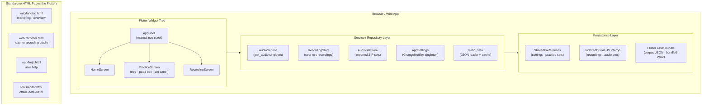
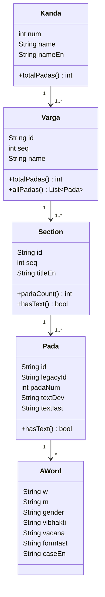
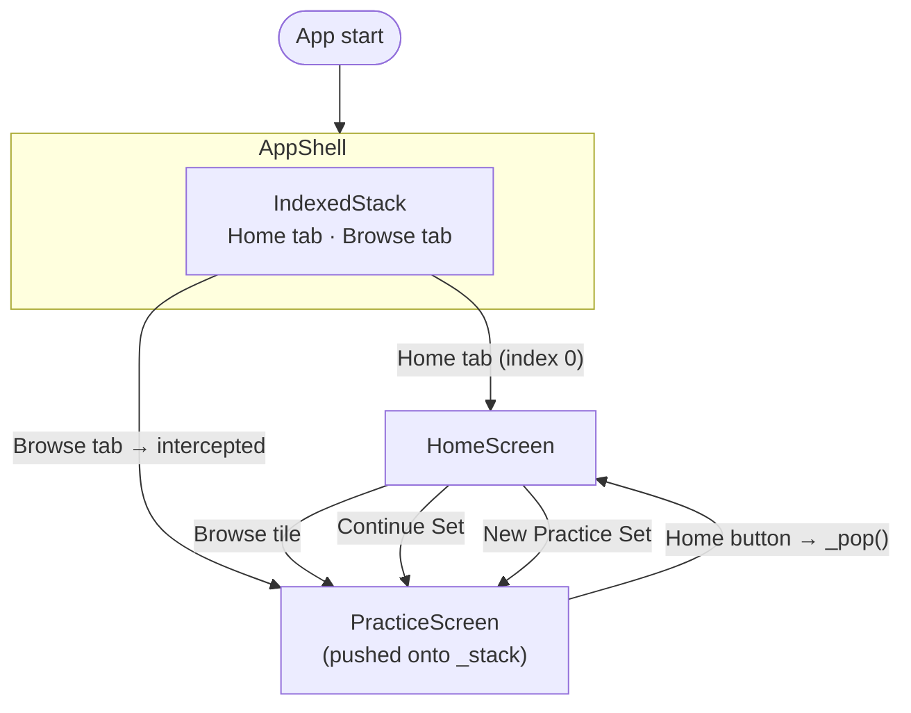
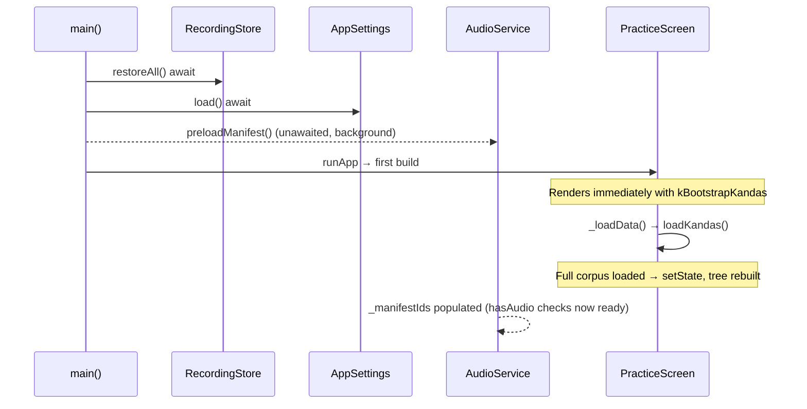
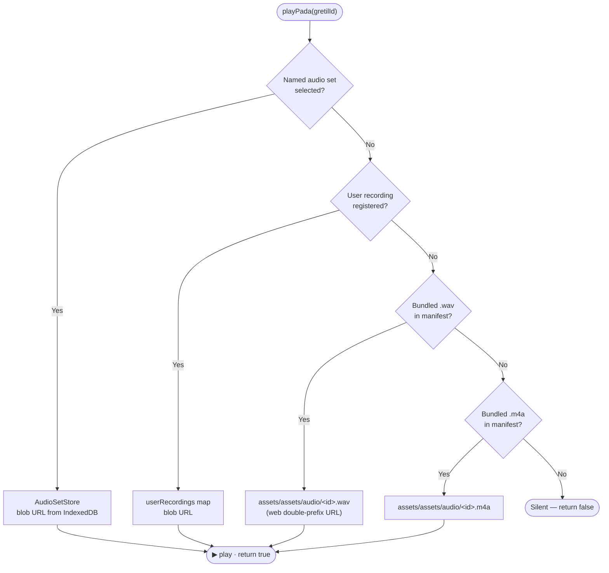
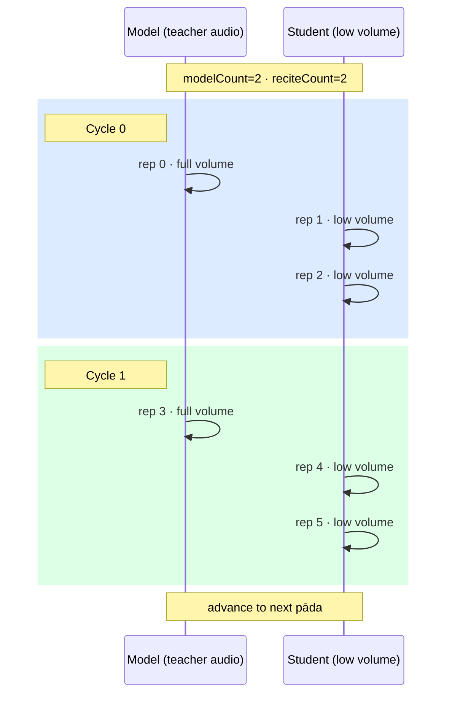
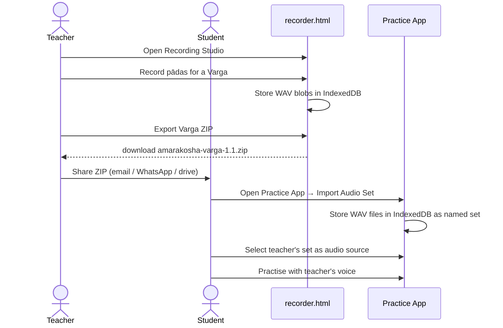

# Amarakosha Practice — Software Architecture

## 1. Purpose and Scope

Amarakosha Practice is a Sanskrit recitation studio for memorizing the *Nāmaliṅgānuśāsana* (Amarakosha) — a classical Sanskrit thesaurus of 2,865 pādas (half-verse lines). The application lets students browse the corpus, listen to reference audio, record their own recitations, and build custom practice sets with configurable playback modes.

**Primary deployment target:** Flutter web, served from GitHub Pages. Native targets (iOS, Android) are possible but the recording and audio-set features are web-only (IndexedDB / JS interop). This document focuses on the web deployment.

---

## 2. High-Level Architecture



---

## 3. Data Model

Defined in `lib/domain/entities/entities.dart`. Pure Dart — no framework dependencies.

### Hierarchy



### Key identifiers

| Field | Example | Usage |
|---|---|---|
| `Pada.id` | `"1.1.11"` | Primary key everywhere — audio filenames, recording keys, practice set serialization |
| `Pada.legacyId` | `"1.1.6.1"` | Kept for backwards compatibility only |
| `Section.id` | `"1.1.2"` | `kanda.varga.seq` format |
| `Varga.id` | `"1.1"` | `kanda.varga` format |

**Corpus size:** 3 Kāṇḍas, 25 Vargas, 63 Sections, 2,865 Pādas (constants in `static_data.dart`).

### AWord fields

Each `Pada` carries a list of `AWord` records parsed from the JSON. Fields: Devanagari form (`w`), meaning (`m`), grammatical gender (`gender`), vibhakti number 1–8 or 0 for avyaya (`vibhakti`), number (`vacana`), stem in IAST (`stem`), surface IAST form (`formIast`), and a composed English case description (`caseEn`).

### Session

`Session` is a transient struct passed between screens carrying the current `Kanda`, `Varga`, `Section`, and repeat count. It is **not** persisted — navigation state lives in `_AppShellState`.

---

## 4. Navigation

`lib/main.dart` — no Flutter `Navigator` or named routes.



- The Home / Browse tab bar uses `IndexedStack` — both tabs are always mounted but only one is visible.
- Pushing any full-screen widget (`PracticeScreen`, etc.) adds it to `_stack`. The `build` method short-circuits when `_stack.isNotEmpty` and renders only `_stack.last`.
- **Browse** tab tap is intercepted: instead of showing `BrowseScreen`, it immediately pushes `PracticeScreen` with the tree pane open.

### PracticeScreen constructor flags

| Flag | Purpose |
|---|---|
| `initialSetIdx` | Which saved practice set to activate on load |
| `startWithNewSet` | Open the new-set creation flow immediately |
| `showSetPanel` | Open the set panel on load (used when continuing a saved set from Home) |

---

## 5. Data Loading

`lib/data/repositories/static_data.dart`

The full corpus (`assets/data/amarakosha_v3.json`, ~2 MB) is loaded once asynchronously and cached in a module-level variable `_cache`.

To avoid a loading spinner on first render, `static_data.dart` exports compile-time constants (`kBootstrapKandas`, `kBootstrapPada`, etc.) that provide immediate first-frame data. The full JSON replaces these once the async load completes.



---

## 6. Audio Pipeline

`lib/data/repositories/audio_service.dart`

`AudioService` is a singleton wrapping a single `just_audio` `AudioPlayer`. On every `playPada(gretilId)` call it tries sources in priority order:



### Web asset URL quirk

Flutter web places assets at `{root}/assets/{pubspec-key}`. Since the pubspec key already starts with `assets/`, audio URLs get a double prefix:

```
key "assets/audio/1.1.11.wav"  →  URL "assets/assets/audio/1.1.11.wav"
```

This is handled in `_loadBundledAsset()` with `Uri.base.resolve('assets/assets/audio/$gretilId.$ext')`.

### Manifest pre-indexing

`preloadManifest()` is called once at startup. It reads the Flutter asset manifest and populates `_manifestIds` — the set of GRETIL IDs that have bundled audio. This enables the synchronous `hasAudio(gretilId)` check used to guard practice set additions and mark pādas in the tree pane.

---

## 7. Persistence

| Store | What | Platform | Key |
|---|---|---|---|
| `RecordingStore` | User voice recordings as WAV blob URLs | Web (IndexedDB) | GRETIL ID |
| `AudioSetStore` | Named ZIP audio sets imported from teacher | Web (IndexedDB) | Set name + GRETIL ID |
| `AppSettings` | Display settings (font, theme, context lines, recite volume) | All (SharedPreferences) | see constant names |
| `SharedPreferences` | Practice sets serialized as JSON | All | `amarakosha_practice_sets_v2` |

### Conditional imports for web-only stores

`RecordingStore` and `AudioSetStore` use conditional imports:

```
recording_store.dart  →  exports RecordingStore
  if (dart.library.io)    recording_store_stub.dart   (no-op)
  else                    recording_store_web.dart     (dart:js_interop + IndexedDB)
```

The same pattern applies to `AudioSetStore`. This keeps native builds compiling cleanly without any web-platform code.

### Practice set persistence

Practice sets are serialized to `SharedPreferences` as a JSON array under the key `amarakosha_practice_sets_v2`. Each set is a `{name, items:[{label, padaIds:[...]}]}` structure. Only GRETIL IDs are stored — `Pada` objects are re-looked-up from the in-memory corpus on load.

---

## 8. State Management

No Riverpod in practice (listed in pubspec but unused). State is managed with plain `StatefulWidget` and:

| Mechanism | Used for |
|---|---|
| `StatefulWidget` / `setState` | All screen-local state (navigation, playback, selection) |
| `AppSettings` (ChangeNotifier singleton) | Cross-screen settings; screens subscribe via `addListener` / `ListenableBuilder` |
| Module-level `_cache` in static_data.dart | Corpus data shared across widgets without re-loading |

`AmarakoshaApp` wraps `MaterialApp` in a `ListenableBuilder` on `AppSettings.instance` so theme changes rebuild the full widget tree.

---

## 9. Theme System

### Flutter app

Defined in `lib/core/theme/app_theme.dart`. Three token namespaces:

| Class | Role |
|---|---|
| `AC` | Color getters: `AC.bg`, `AC.accent`, `AC.sidebar`, etc. All are `static Color get` (never `const`) — they delegate to `AppSettings.instance.colors` |
| `AT` | Text style factories: `AT.garamond(size, ...)`, `AT.devanagari(size, ...)` |
| `AD` | Box decoration helpers: `AD.card(...)`, `AD.chip()`, `AD.activeLine()` |

**Five themes** defined in `AppColorSchemes`:

| ID | Label | Character |
|---|---|---|
| `parchment` | Parchment | Warm cream + terracotta (default) |
| `night` | Night | Dark warm + amber accents |
| `slate` | Slate | Cool grey-blue + steel-blue |
| `minimal` | Minimal | Clean white/zinc + indigo |
| `forest` | Forest | Sage green palette |

**Rule:** never use raw `Color(...)` literals or inline `TextStyle(...)` in widget code. Always use `AC.*`, `AT.*`, `AD.*`.

**Rule:** never add `const` to widgets that reference `AC.*` — they are runtime getters, not compile-time constants.

### HTML pages (recorder, editor, help, landing)

All standalone HTML pages use a `[data-theme]` CSS approach:

```html
<html data-theme="parchment">
<head>
  <script>
    /* Runs before CSS paint — no flash on reload */
    const t = localStorage.getItem('amara-theme');
    if (t) document.documentElement.dataset.theme = t;
  </script>
  <style>
    html[data-theme="parchment"] { --bg: #EDE0C0; --accent: #7A3A10; ... }
    html[data-theme="night"]     { --bg: #1E150A; --accent: #D4940A; ... }
    html[data-theme="forest"]    { --bg: #E4EADE; --accent: #3A6820; ... }
    /* ... slate, minimal */
  </style>
```

Theme picker renders as colored dot buttons. Clicking saves to `localStorage['amara-theme']` and updates `document.documentElement.dataset.theme`.

---

## 10. Practice Screen in Detail

`lib/presentation/screens/practice_screen.dart` — the core user-facing screen.

### Desktop layout (> 768 px)

```
┌─────────────────────────────────────────────────────────┐
│  [Home]  [breadcrumb]            [Set btn] [Gear] [Mic] │
├──────────────┬──────────────────────────┬───────────────┤
│  Tree pane   │    Practice pane          │  Set panel    │
│  (scrollable)│    ┌──────────────────┐  │               │
│              │    │  Pada box  /     │  │  item list    │
│  Kanda       │    │  Playlist view   │  │               │
│   └ Varga    │    └──────────────────┘  │  settings     │
│      └ Sec   │    Audio player          │               │
│         └ P  │    Prev / Next           │  Play Set btn │
└──────────────┴──────────────────────────┴───────────────┘
```

On mobile (≤ 768 px), the tree pane becomes a slide-in overlay and the set panel becomes a modal bottom sheet.

### Pada box (`_buildPadaBox` / `_buildBoxEntries`)

Shows context pādas before and after the active pāda in a single unified box. Context extends **across section and varga boundaries** using a flat corpus list. Varga and section headings are inserted at boundaries. The active pāda is highlighted; inactive pādas are tappable (navigate).

Context line counts:
- Browse mode: `AppSettings.contextBefore` / `contextAfter`
- Set playback: `AppSettings.setPlaylistContextBefore` / `setPlaylistContextAfter`

### Playlist view (`_buildSetPlaylistView`)

Active during set playback (`_setPlaying`) or step-mode wait (`_waitingForStep`). Shows all set pādas in order with the active one highlighted. Context pādas from `_buildBoxEntries` are injected around the active pāda; non-active set pādas that would appear as context entries are suppressed (via a pre-computed `contextIds` set) to prevent duplication. Auto-scrolls to the active pāda via `GlobalKey` + `Scrollable.ensureVisible`.

### Guided Practice playback model

Controlled by `_modelCount` (teacher cycles) and `_reciteCount` (student recitations per cycle).



`cyclePos = _setCurPadaRep % (1 + _reciteCount)`. `cyclePos == 0` → model play. Total reps = `_modelCount × (1 + _reciteCount)`.

Student volume is `AppSettings.reciteVolumePct` (0–20 %, default 10 %). A configurable gap (`_reciteGapSec`, 0–5 s) can be inserted between consecutive student recitations.

### Audio guard

Before a pāda can be added to a practice set, `AudioService.instance.hasAudio(pada.id)` is checked synchronously. Pādas without audio are visible in the tree (for browsing) but cannot be added to a set. Adding a range or section filters to audio-only pādas and reports how many were skipped.

---

## 11. Teacher → Student Workflow



---

## 12. Key File Map

```
lib/
  main.dart                          App entry, AppShell, navigation stack
  domain/entities/entities.dart      Data model (pure Dart)
  data/repositories/
    static_data.dart                 JSON loader + bootstrap constants
    audio_service.dart               Playback singleton (just_audio)
    recording_store.dart             User voice recordings (conditional import)
    recording_store_web.dart         Web impl (IndexedDB via js_interop)
    recording_store_stub.dart        Native no-op
    audio_set_store.dart             Named ZIP audio sets (conditional import)
    audio_set_store_web.dart         Web impl (IndexedDB via js_interop)
    audio_set_store_stub.dart        Native no-op
  core/
    settings/app_settings.dart       ChangeNotifier singleton, SharedPreferences
    theme/app_theme.dart             AC / AT / AD tokens, 5 color schemes
  presentation/
    screens/
      home_screen.dart               Home tab (continue set, new set, browse)
      practice_screen.dart           Main recitation screen
      browse_screen.dart             Varga picker (kept, not reachable by default)
      recording_screen.dart          In-app mic recording
    sheets/
      grammar_sheet.dart             Long-press word grammar detail sheet
    widgets/
      shared_widgets.dart            SettingRow, AStepperWidget, display settings sheet

assets/
  data/amarakosha_v3.json            Full corpus (GRETIL-based)
  audio/<gretilId>.wav               Bundled audio (keyed by Pada.id)

web/
  index.html                         Flutter web entry point
  landing.html                       Marketing / overview page
  help.html                          User help
  recorder.html                      Teacher recording studio (standalone HTML)

tools/
  editor.html                        Offline data editing utility (standalone HTML)
  strip_fields.py                    JSON field cleanup script
```

---

## 13. Build and Deploy

```bash
# Development
flutter run -d chrome

# Production build
flutter build web --release --base-href /amarakosha/

# Deploy to GitHub Pages
.\deploy.ps1          # Windows
./deploy.sh           # macOS / Linux
```

The `--base-href /amarakosha/` flag is required because the app is served from a subdirectory of the GitHub Pages domain. The deploy script copies the `build/web/` output to the `gh-pages` branch.

---

## 14. Key Dependencies

| Package | Purpose |
|---|---|
| `just_audio` | Cross-platform audio player |
| `shared_preferences` | Key-value persistence (settings + practice sets) |
| `google_fonts` | EB Garamond (UI text) + NotoSerifDevanagari |
| `record` | Microphone recording (in-app RecordingScreen) |
| `archive` | ZIP import/export for audio sets |

Sanskrit text uses `TiroDevanagarSanskrit` (bundled TTF in `assets/fonts/`). UI text uses EB Garamond via Google Fonts.

---

## 15. Design Decisions and Constraints

**Manual navigation stack** — `Navigator` was avoided because the app has a very flat navigation depth (never more than one screen on the stack at a time) and the `IndexedStack` tab pattern would conflict with Flutter's `Navigator` history. The manual list is simpler and gives full control over back-button behavior.

**No state management library** — Riverpod is listed as a dependency (a remnant) but unused. The app's state is simple enough that `StatefulWidget` + a single `ChangeNotifier` singleton for settings covers all cases without additional complexity.

**IndexedDB for recordings** — `SharedPreferences` is limited to small string values. Audio blobs can be tens of megabytes, so IndexedDB is necessary for web. The conditional import pattern (`_web.dart` / `_stub.dart`) keeps native builds clean.

**Bootstrap constants** — Without these, the first frame would require an async JSON load (~300 ms on slow connections), causing a visible loading flash. The bootstrap constants give a rendered first frame immediately.

**Double `assets/` prefix** — A known Flutter web quirk. The asset manifest key includes `assets/` as part of the path, but the dev server also prefixes `assets/`. Rather than fighting this, the audio service explicitly constructs the double-prefix URL for web targets.

**Audio guard** — Pādas without bundled audio are shown in the tree (for textual study) but cannot be added to practice sets, since the set playback is audio-driven and a silent pāda would stall the queue.
